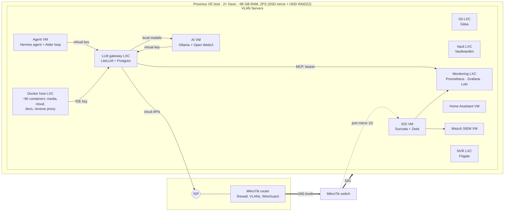

# Homelab

One server at home that runs the household's services and that I also use to try out security and AI infrastructure.
This repository is a cleaned-up subset of the real configuration, which lives in a private repo. Addresses, domains and
names here are placeholders.

## Contents

- [`docs/ai-gateway.md`](docs/ai-gateway.md): all AI clients (chat UI, IDE, coding agents, an autonomous agent) use one
  OpenAI-compatible LiteLLM endpoint with per-client keys, monthly budgets, fallback chains, a complexity router and a
  read-only MCP gateway.
- [`docs/agent-hardening.md`](docs/agent-hardening.md): how the autonomous agent is locked down. No internet, read-only
  data access, no privilege escalation, it can't edit its own config or code, and changes go through pull requests.
- [`docs/mcp.md`](docs/mcp.md): Proxmox, Prometheus/Loki, SIEM and IDS data exposed to LLMs over MCP, with no tool that
  can write anything and per-key permissions on top.
- [`docs/config-export.md`](docs/config-export.md): a nightly job that copies the config of the host and every guest into
  git, with secrets removed and checked before anything is pushed.
- [`docs/operations.md`](docs/operations.md): health checks for each app through the reverse proxy, an external
  dead-man's switch for monitoring and backups, a nightly off-site backup of the important data, and images pinned to
  digests with a weekly update report.
- [`docs/network-security.md`](docs/network-security.md): a port mirror feeding Suricata and Zeek, Wazuh with custom
  RouterOS decoders, and how I tracked capture loss down to the queue of a tap interface on the hypervisor.

## Architecture

There are separate VLANs for management, servers, Wi-Fi clients, IoT and cameras. The router routes and filters
traffic between them. Remote access is over WireGuard, and the VPN port is the only thing forwarded from outside.

## Repository layout

| Path | Contents |
|---|---|
| [`docs/`](docs) | Write-ups, start here |
| [`ai-gateway/`](ai-gateway) | LiteLLM config: model aliases, fallbacks, complexity router, MCP servers, budgets |
| [`mcp/`](mcp) | Read-only homelab MCP server (Python), auth proxy, compose file |
| [`agent-hardening/`](agent-hardening) | nftables egress allowlist per UID, systemd sandboxing drop-in |
| [`config-export/`](config-export) | Nightly export: collector, redaction, secret scanner, systemd timer |
| [`monitoring/`](monitoring) | App health probes (blackbox modules, targets, alert rule), watchdog for the dead-man's switch, read-only Loki proxy, hookscript for the IDS capture NIC |
| [`backup/`](backup) | Daily off-site backup of the important data from atomic ZFS snapshots, with a metric and healthchecks pings |
| [`updates/`](updates) | Image pinning, registry digest check, weekly update report, helper to update one service |

## Stack

Proxmox VE (LXC + KVM, ZFS) · MikroTik RouterOS (VLANs, WireGuard, port mirror) · Docker / Portainer · Nginx Proxy Manager ·
Prometheus · Grafana · Loki · Alloy · Wazuh · Suricata · Zeek · LiteLLM · Ollama · Open WebUI · Hermes Agent · Aider ·
Gitea · Coder · code-server · Home Assistant · Frigate · UrBackup · restic (off-site) · healthchecks.io

## License

MIT, see [`LICENSE`](LICENSE). The configs are examples, so change the addresses and secrets for your own setup.
