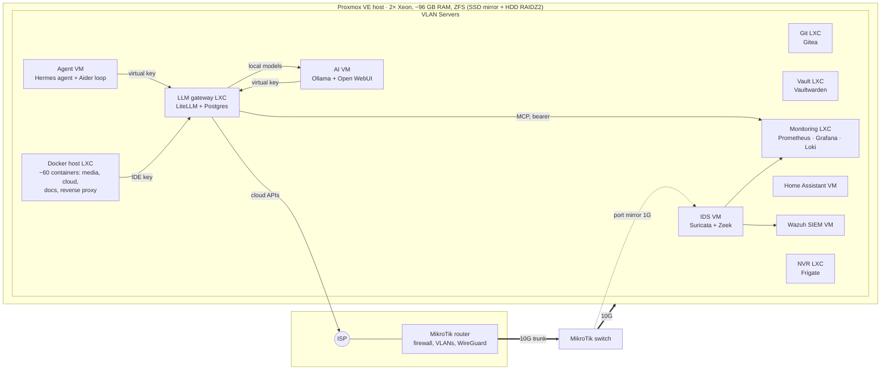

# Homelab

A single-server home lab that runs the household's services and doubles as a security and AI-infrastructure playground.
This repository is a **curated, sanitized** write-up: the design decisions and the reusable pieces. The real configuration
lives in a private repository (addresses, domains and names here are placeholders).

**What makes it interesting**

- **One AI gateway for every client** — chat UI, IDE, coding agents and an autonomous agent all talk to a single
  OpenAI-compatible endpoint with per-client keys, monthly budgets, fallback chains, a complexity-based router and a
  read-only **MCP gateway** for infrastructure tools. → [`docs/ai-gateway.md`](docs/ai-gateway.md)
- **An autonomous agent that cannot hurt the host** — no internet, read-only data access, no privilege escalation,
  cannot rewrite its own config or code, changes only via pull requests. → [`docs/agent-hardening.md`](docs/agent-hardening.md)
- **Read-only infrastructure tools over MCP** — Proxmox, Prometheus/Loki, SIEM and IDS alerts exposed to LLMs without a
  single write path, behind per-key permissions. → [`docs/mcp.md`](docs/mcp.md)
- **Nightly configuration export with secret redaction** — every config file from the host and all guests lands in git,
  secrets stripped and verified before anything leaves the server. → [`docs/config-export.md`](docs/config-export.md)
- **Operations that catch silent failures** — app health probes through the reverse proxy, an external dead-man's
  switch for the monitoring and the backups, the critical state off-site every night, every image pinned to a digest
  with a weekly update report. → [`docs/operations.md`](docs/operations.md)
- **Network security monitoring** — port mirror → Suricata IDS + Zeek, Wazuh SIEM with custom RouterOS decoders,
  capture-loss troubleshooting down to the hypervisor tap queue. → [`docs/network-security.md`](docs/network-security.md)

## Architecture

VLANs separate management, servers, Wi-Fi clients, IoT and cameras; inter-VLAN traffic is routed and filtered on the
router. Remote access is WireGuard only — nothing is port-forwarded except the VPN.

## Repository layout

| Path | Contents |
|---|---|
| [`docs/`](docs) | Design write-ups (start here) |
| [`ai-gateway/`](ai-gateway) | LiteLLM config: model aliases, fallbacks, complexity router, MCP servers, budgets |
| [`mcp/`](mcp) | Read-only homelab MCP server (Python), auth proxy, compose file |
| [`agent-hardening/`](agent-hardening) | nftables per-UID egress allowlist, systemd sandboxing drop-in |
| [`config-export/`](config-export) | Nightly export pipeline: collector, redaction, secret scanner, systemd timer |
| [`monitoring/`](monitoring) | App health probes (blackbox modules, targets, alert), dead-man's switch watchdog, read-only Loki proxy, hookscript for the IDS capture NIC |
| [`backup/`](backup) | Daily off-site backup of the critical state from atomic ZFS snapshots, with metric and healthchecks pings |
| [`updates/`](updates) | Image pinning, registry digest check, weekly update report, one-service update helper |

## Stack

Proxmox VE (LXC + KVM, ZFS) · MikroTik RouterOS (VLANs, WireGuard, port mirror) · Docker / Portainer · Nginx Proxy Manager ·
Prometheus · Grafana · Loki · Alloy · Wazuh · Suricata · Zeek · LiteLLM · Ollama · Open WebUI · Hermes Agent · Aider ·
Gitea · Coder · code-server · Home Assistant · Frigate · UrBackup · restic (off-site) · healthchecks.io

## License

MIT — see [`LICENSE`](LICENSE). Configs are examples; adapt addresses and secrets to your environment.
