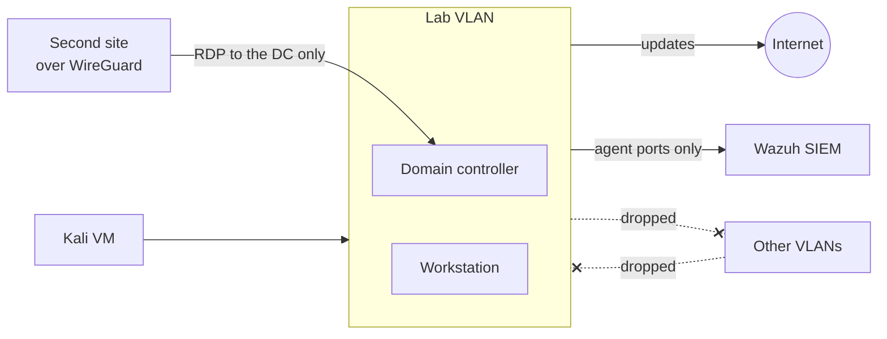

# Active Directory attack lab

A small Windows domain that exists to be attacked. A Kali VM runs the usual AD attacks against it, and the same
monitoring stack that watches the rest of the network (Wazuh, Sysmon, Suricata, Zeek) has to catch them. It's off by
default and only runs during an exercise.

## Layout

| Guest | Role |
|---|---|
| Domain controller | Windows Server 2025, its own forest under a lab-only subdomain, DNS for the lab |
| Workstation | Windows 11, joined to the domain, the victim for credential theft and lateral movement |
| Kali VM | Attacker |

Both Windows machines run Sysmon and a Wazuh agent. The domain is seeded with deliberately weak accounts: two service
accounts with SPNs and crackable passwords (Kerberoasting), one user without Kerberos pre-authentication (AS-REP
roasting), one ordinary user with replication rights on the domain object (DCSync), and a Domain Admin that logs on to
the workstation so its credentials end up in LSASS.

The whole thing is scripted, and two snapshots make an exercise repeatable: `BASELINE_CLEAN` right after promotion and
`LAB_SEEDED` after the seed script. After an exercise I roll back to `LAB_SEEDED` and nothing the attacker changed
survives.

## Isolation

A compromised lab domain must not be able to reach anything real, so it lives on its own VLAN with a short allow list
on the router:

- Lab to the rest of the LAN: dropped, except the Wazuh agent ports on the SIEM.
- Rest of the LAN to the lab: dropped, except RDP from the management VLAN and from the second site, and only to the
  domain controller.
- The switch carries the lab VLAN tagged on the hypervisor uplink, so the port mirror feeding the IDS sees lab traffic
  too.

The RDP path from the second site was a small lesson in where routes come from. Adding the lab subnet to the WireGuard
client's AllowedIPs on the remote router changed nothing: traceroute still went out through the local ISP. On that
router the routes to home are installed by a failover script that health-checks the tunnel and falls back to
Tailscale, and that script has its own list of subnets. The subnet had to go there.

## Detection

Audit policy ([`../ad-lab/Enable-Auditing.ps1`](../ad-lab/Enable-Auditing.ps1)) turns on the Kerberos, directory
service access, logon and group management subcategories, and adds a SACL on the domain object so that use of the
replication rights is logged at all (event 4662 doesn't appear without it). Custom Wazuh rules
([`../ad-lab/ad_rules.xml`](../ad-lab/ad_rules.xml)) sit on top of the stock Windows rules:

| Attack | Signal | Rule |
|---|---|---|
| Kerberoasting | 4769, RC4 ticket for a non-machine SPN; a burst rule for many in a minute | 100700, 100710 |
| AS-REP roasting | 4768 with pre-authentication type 0 | 100701 |
| Encryption downgrade | 4768 with an RC4 TGT (weak, supporting signal) | 100702 |
| DCSync | 4662 with a replication GUID from an account that isn't a DC | 100703 |
| Pass-the-hash | 4624 logon type 9 via `seclogo` with Negotiate | 100704 |
| Lateral movement | 4624 NTLM network logon without a session key (weak) | 100705 |
| Persistence | member added to Domain Admins or another privileged group | 100706 |

Recon (BloodHound, LDAP queries) doesn't leave much in the Windows logs, so for that I rely on Zeek's LDAP and
Kerberos logs from the mirror.

## Status

The lab is built and seeded and the workstation is in the domain. The rules are written but haven't been checked
against real attack traffic yet. That's the first exercise, and some will need adjusting. The Kerberoasting
burst rule already did: it first wanted 8 tickets in a minute, which a lab with two roastable accounts can never
produce, so it now fires on tickets for two different services from one source within a minute.
