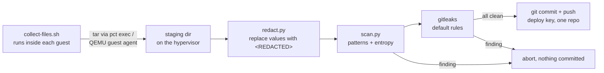

# Nightly configuration export with secret redaction

Every day the config of the lab goes into a private Git repository: Proxmox `/etc/pve`, firewall rules, compose files and
Portainer stacks, app configs, SIEM and IDS configs, systemd units and a Docker inventory for each host. The git history
works as a changelog of the whole lab, and I can rebuild any service from it.

Collecting the files was easy. Most of the work went into making sure no secret ends up in the repository.

## Pipeline

- [`collect-files.sh`](../config-export/collect-files.sh) runs inside each guest. It has a fixed list of config paths
  for each service (not whole data directories) and takes only small text files. Caches, databases, certificates, keys
  and dependency trees are skipped. Containers are reached with `pct exec` and VMs through the QEMU guest agent, which
  returns the tar base64-encoded in its JSON output, so SSH isn't needed.
- [`docker-inventory.sh`](../config-export/docker-inventory.sh) records image, ports, mounts, networks and environment
  of containers that were started without a compose file.
- [`redact.py`](../config-export/redact.py) keeps the structure and the key names and replaces the values. It looks for
  key names that suggest a secret in env, YAML, JSON, XML and INI files, credentials in URLs, Authorization headers,
  known token formats (`sk-…`, `ghp_…`, JWTs, PEM private keys and others), high-entropy strings and hex API keys. Key
  files, databases and binaries are dropped.
- After redaction three checks run: the redaction patterns must not match anything any more, then an entropy scanner
  ([`scan.py`](../config-export/scan.py)), then [gitleaks](https://github.com/gitleaks/gitleaks). If any of them finds
  something, the run stops and nothing is committed.
- The push uses a deploy key that can write only to this one repository. A systemd timer runs the job daily.

## What went wrong the first time

The first export passed both of my own checks and still pushed real API keys. gitleaks found them on the next run.

- Entropy checks miss hex keys. A 32-character hex API key has at most 4 bits of entropy per character, so a threshold
  of 4.2 that works for base64 secrets misses all of them. Hex tokens of 32, 48 or 96 characters are now treated as
  secrets. 40 and 64 are still allowed because those are SHA-1 and SHA-256 digests.
- Short key names matter. Homepage widgets use `key:` and Mylar uses `comicvine_api`. The name rules had to cover the
  short forms without matching words like `keyboard` or `monkey`.
- The last check should be a scanner I didn't write. My own rules have the same blind spots I do.
- Fixing HEAD isn't enough, the history has to be fixed too. I replaced the leaked commit with a force-push and pruned
  the unreachable objects on both sides (`git reflog expire` and `git gc --prune=now`) before anyone had cloned the repo.
- Debug output can leak as well. A "masked" preview that kept the first few characters of each value showed the real
  beginnings of passwords. The output now shows only file, line, length and the character classes (`a…9-A…`).
