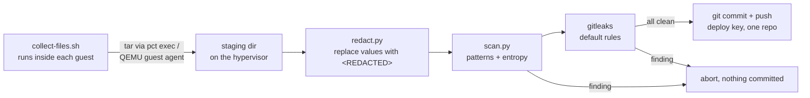

# Nightly configuration export with secret redaction

Every config file that matters — Proxmox `/etc/pve`, firewall rules, compose files and Portainer stacks, app configs,
SIEM/IDS configs, systemd units, a Docker inventory per host — is exported every day into a private Git repository.
Git history becomes a changelog of the whole lab, and any service can be rebuilt from it.

The hard part is not collecting files; it is making sure **no secret ever reaches the repository**.

## Pipeline

- **Collection** ([`collect-files.sh`](../config-export/collect-files.sh)) runs *inside* each guest: an explicit list of
  config paths per service (not whole data directories), small text files only, with caches, databases, certificates,
  keys and dependency trees pruned. Containers are reached with `pct exec`, VMs through the QEMU guest agent
  (base64-encoded tar in the agent's JSON output — no SSH needed).
- **Docker inventory** ([`docker-inventory.sh`](../config-export/docker-inventory.sh)) records image, ports, mounts,
  networks and environment for containers started without a compose file.
- **Redaction** ([`redact.py`](../config-export/redact.py)) keeps structure and key names, replaces values:
  secret-looking key names in env/YAML/JSON/XML/INI, credentials in URLs, Authorization headers, well-known token
  formats (`sk-…`, `ghp_…`, JWTs, PEM private keys…), high-entropy strings and hex API keys. Key files, databases and
  binaries are dropped.
- **Three gates**: the redaction patterns must no longer match, an entropy scanner ([`scan.py`](../config-export/scan.py))
  and [gitleaks](https://github.com/gitleaks/gitleaks). Any finding aborts the run; nothing is committed.
- **Publishing** uses a deploy key with write access to that single repository; a systemd timer runs it daily.

## Lessons (from an actual incident)

The first export passed my own two gates and still pushed real API keys. gitleaks caught them on the next run.

- **Hex keys defeat entropy checks.** A 32-char hex API key has at most 4 bits/char of entropy; a 4.2 threshold that
  works for base64 secrets misses every hex key. Treat 32/48/96-hex tokens as secrets explicitly (40/64 stay allowed:
  those are SHA-1/SHA-256 digests).
- **Bare key names matter.** Homepage widgets use `key:`; Mylar uses `comicvine_api`. Name-based rules need the short
  forms, guarded so `keyboard` or `monkey` do not match.
- **Use an independent scanner as the last gate.** Your own rules share your blind spots.
- **Fix history, don't just fix HEAD.** The leaked commit was replaced (force-push) and unreachable objects pruned
  on both sides (`git reflog expire` + `git gc --prune=now`), before anyone cloned the repo.
- **Previews leak too.** While debugging, a "masked" preview that kept the first characters of each value showed real
  password prefixes. Masks now show only file, line, length and a character-class shape (`a…9-A…`).
