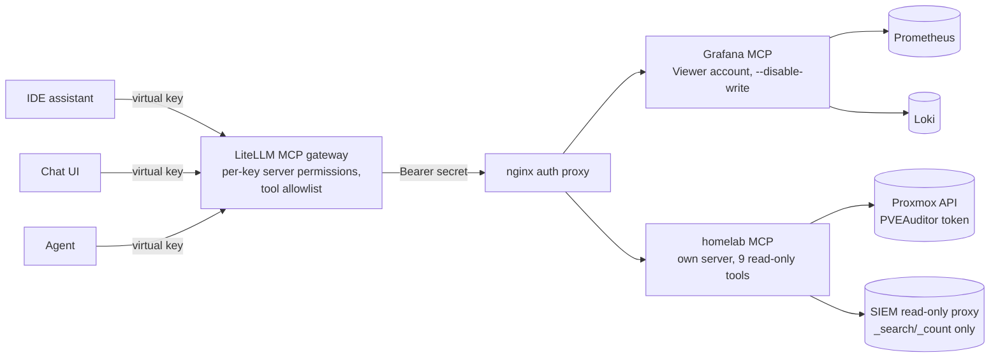

# Read-only infrastructure tools over MCP

LLM clients (IDE assistant, chat UI, the agent) can query the lab through the Model Context Protocol. Design rule:
**there is no write path** — not "writes need confirmation", but no tool that can change anything.

## Servers

- **Grafana MCP** (official) with a *Viewer* service account and `--disable-write`. It exposes 62 tools; the gateway's
  `allowed_tools` keeps 20 (Prometheus, Loki, dashboards, alert rules). Fewer tools = less context and less to misuse.
  Loki is reached through Grafana, never directly, because Loki itself has no auth and a delete API.
- **homelab MCP** — a small Python server ([`../mcp/homelab-mcp/server.py`](../mcp/homelab-mcp/server.py)):
  Proxmox host/guest status, storage, failed tasks, backup age, SIEM alert summary and search, IDS signature stats.
  Tools that return log data carry a warning in their description that the content is untrusted.

## Defence in depth

1. **Credentials are read-only at the source** — the Proxmox token returns 403 on reboot/config calls; the SIEM user
   has `read` on the alert index only and goes through an nginx that permits only `_search`/`_count`.
2. **Auth proxy** — the MCP servers are unreachable without a bearer secret that only the gateway holds.
3. **Per-key permissions in the gateway** — the family chat key and the coding loop key have `no-mcp-servers`.
4. **Tool allowlist** in the gateway.

## Gotchas

- Grafana MCP rejects proxied requests with `forbidden: host not allowed` (DNS-rebinding protection); the proxy sets
  `Host: localhost:8000`.
- nginx bind-mounted config edited with `sed -i` is a new inode — reload does nothing, restart the container.
- Tool results go to whichever model the user picked. The gateway cannot bind MCP to specific models, so "don't ask
  infrastructure questions to free-tier models" is a documented rule, not an enforced one.
