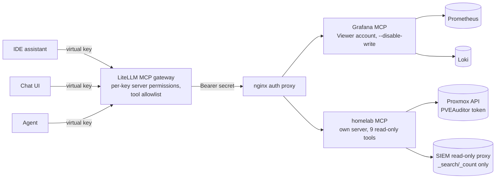

# Read-only infrastructure tools over MCP

LLM clients (the IDE assistant, the chat UI and the agent) can query the lab through the Model Context Protocol. None of
the tools can change anything. There is no write path, so there is nothing that needs a confirmation step.

## Servers

- The official Grafana MCP server, with a Viewer service account and `--disable-write`. It has 62 tools and the
  gateway's `allowed_tools` leaves 20 of them (Prometheus, Loki, dashboards, alert rules). Fewer tools use less context
  and give the model less to misuse. Loki is queried only through Grafana, because Loki has no auth of its own and has
  a delete API.
- My own small Python server, [`../mcp/homelab-mcp/server.py`](../mcp/homelab-mcp/server.py). It returns Proxmox host
  and guest status, storage, failed tasks, backup age, a SIEM alert summary and search, and IDS signature stats. The
  description of every tool that returns log data warns that the content is untrusted.

## Layers of protection

1. The credentials are read-only on the backend side. The Proxmox token gets 403 on reboot or config calls. The SIEM
   user can only read the alert index, and its requests go through an nginx that allows only `_search` and `_count`.
2. The MCP servers can't be reached without a bearer secret, and only the gateway has it.
3. The gateway has permissions for each key. The family chat key and the coding loop key get `no-mcp-servers`.
4. The gateway also has an allowlist of tools.

## Problems I ran into

- Grafana MCP rejected requests coming through the proxy with `forbidden: host not allowed`, which is its protection
  against DNS rebinding. The proxy now sends `Host: localhost:8000`.
- Editing a bind-mounted nginx config with `sed -i` creates a new inode, so a reload doesn't see the change. The
  container has to be restarted.
- Tool results go to whichever model the user picked, and the gateway can't limit MCP to particular models. "Don't ask
  free-tier models about the infrastructure" is a rule I wrote down, and nothing enforces it.
